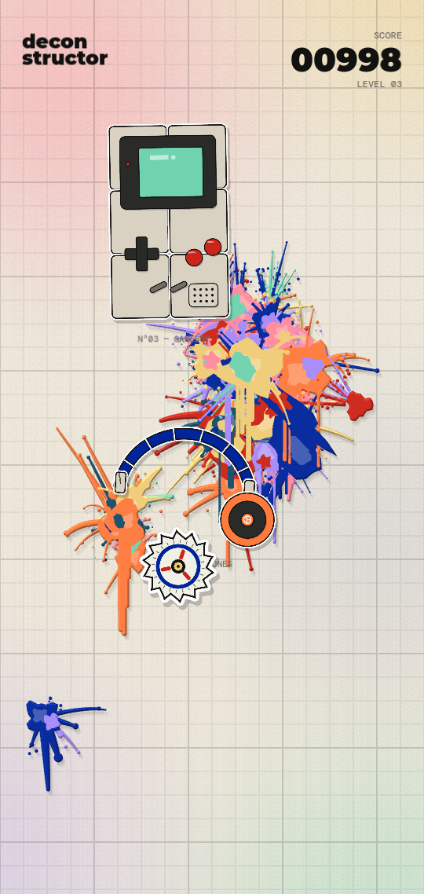
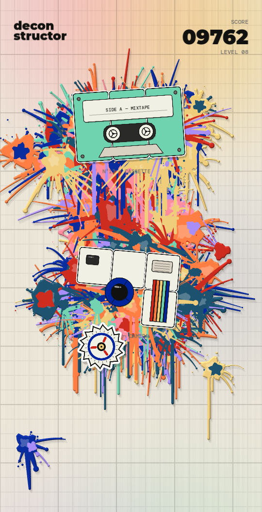
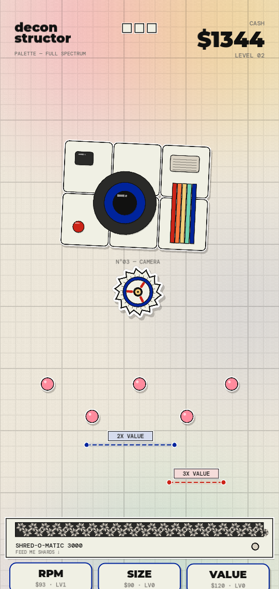

# Deconstructor

A mobile arcade game made in **Godot 4**: take retro gadgets apart with a spinning saw. Cassettes, game consoles, cameras and boomboxes break into parts and burst into paint, and every part you cut earns cash.

<p align="center">
  
  
  
</p>

## How it plays
- **Jobs:** each level is a precision puzzle. You get a power budget, tougher material costs more, and cutting a weak point drops a whole section for the price of one part. Every 5th job is a boss.
- **Rush mode:** 60 seconds. Objects are thrown up from the bottom, swipe to slice them and catch the pieces. Slicing several at once pays a bonus, bombs cost 5 seconds.
- **Frenzy:** three golden parts in a row unlock 8 seconds of double cash and a bigger saw.
- **Upgrades:** spend cash on saw RPM, size and part value. Stars from Jobs and Rush unlock new modes.

## Built with
- Godot 4 (GDScript), portrait, mobile renderer
- Gadgets, paint and effects drawn in code; synthesized sound effects (`audio/`)
- Custom shaders (`shaders/`)

## Project layout
```
game/       game loop, jobs, rush mode, frenzy, rewards, menu
player/     the saw blade and its visuals
objects/    the gadget library and bosses
paint/      paint splats and drips
fragments/  broken pieces and physics
collector/  the shredder that collects shards
audio/      procedural sound synths
ui/, juice/ HUD, feedback and screen shake
```

## Run it
Open `project.godot` in Godot 4 and press Play. The window is portrait (phone-sized).
